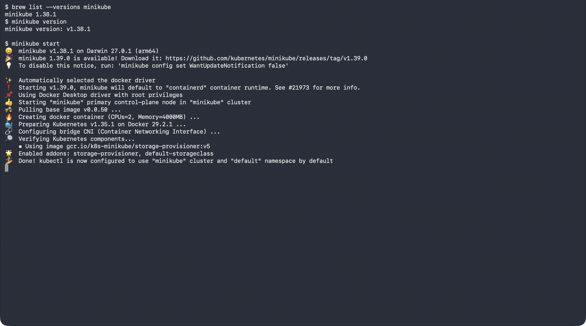
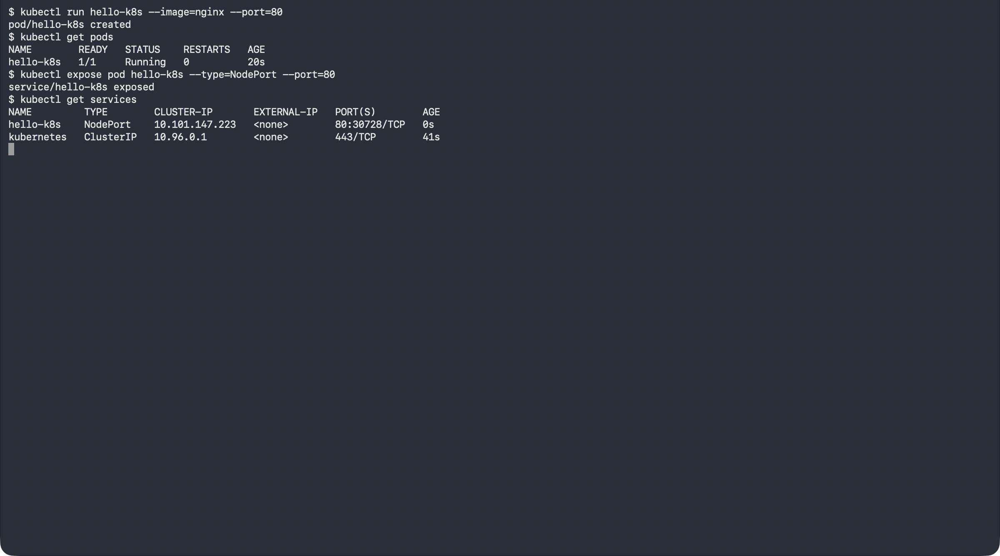
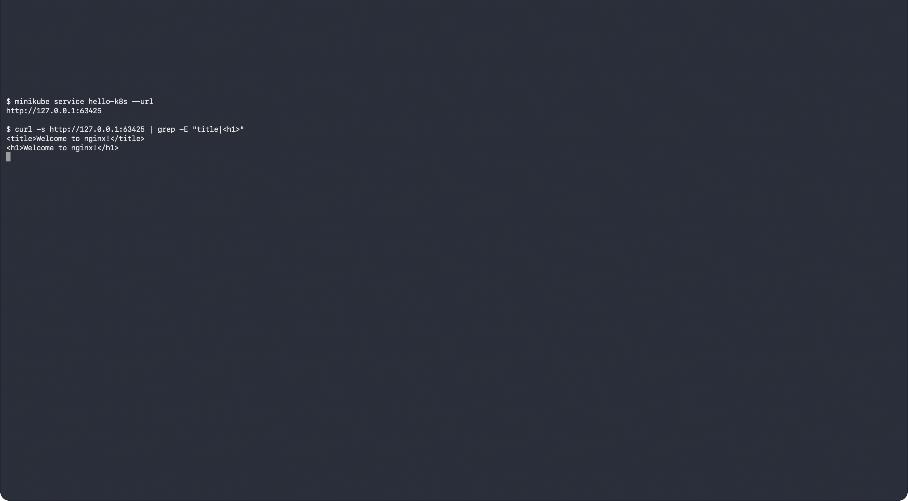

# Exercise 1: Kubernetes Getting Started

## Objective

Deploy an Nginx application as a Kubernetes Pod using Minikube and verify that it is running successfully.

## Steps

### 1. Install Minikube

Minikube was installed on macOS using Homebrew.

```bash
brew install minikube
```

### 2. Start Minikube

Started the local Kubernetes cluster using:

```bash
minikube start
```

Minikube used Docker as the driver.



### 3. Create the Nginx Pod

Created an Nginx Pod using:

```bash
kubectl run hello-k8s --image=nginx --port=80
```

### 4. Verify the Pod

Checked the Pod status using:

```bash
kubectl get pods
```

The Pod was running successfully.

### 5. Expose the Pod

Exposed the Pod using a NodePort service:

```bash
kubectl expose pod hello-k8s --type=NodePort --port=80
```



### 6. Access the Nginx Application

```bash
minikube service hello-k8s --url
```

Opening the URL returned the **"Welcome to nginx!"** page, confirming that the Nginx Pod was deployed and running.



## Result

Successfully deployed and accessed an Nginx application using Kubernetes and Minikube.
